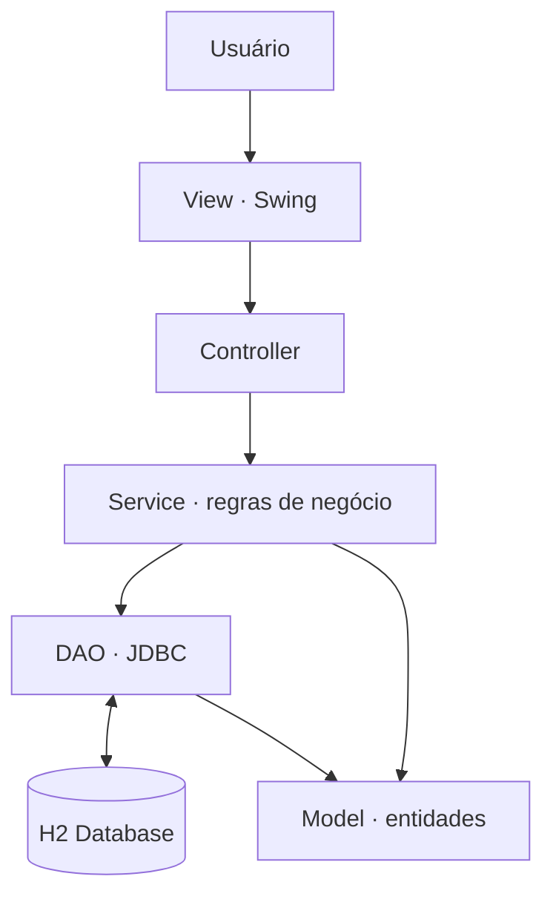

<div align="center">

# EstoqueFlow

**Sistema desktop de controle e movimentação de estoque desenvolvido em Java.**


Projeto acadêmico de **Programação Orientada a Objetos**, com foco no padrão **MVC**, separação de responsabilidades e persistência de dados.

</div>

---

## Sobre o projeto

O **EstoqueFlow** é uma aplicação Java para cadastrar produtos, registrar entradas e saídas de mercadorias e consultar o histórico de movimentações. A aplicação utiliza um banco de dados **H2 em arquivo**, dispensando a instalação de um servidor de banco de dados.

A interface desktop está sendo desenvolvida em **Java Swing**, com apoio do **Swing UI Designer do IntelliJ IDEA**.

> **Estado atual:** o núcleo de persistência e movimentações está funcional e foi validado por execuções manuais. A interface gráfica completa ainda está em desenvolvimento.

## Funcionalidades

| Recurso | Situação |
| :-- | :-- |
| Cadastro de produtos via DAO | ✅ Implementado |
| Listagem e busca de produtos por código | ✅ Implementado |
| Persistência local com H2 + JDBC | ✅ Implementado |
| Entrada e saída de mercadorias | ✅ Implementado |
| Validação de estoque insuficiente | ✅ Implementado |
| Histórico de movimentações por produto | ✅ Implementado |
| Transações com `commit` e `rollback` | ✅ Implementado |
| Tela gráfica completa para operar o sistema | 🚧 Em desenvolvimento |
| Edição de produtos e pesquisa na interface | 📋 Planejado |
| Indicadores e alertas visuais de estoque baixo | 📋 Planejado |

## Tecnologias

- **Java 21** — linguagem e regras de negócio
- **Java Swing** — interface gráfica desktop
- **IntelliJ IDEA + Swing UI Designer** — ambiente e criação de formulários
- **Gradle (Groovy DSL)** — build e dependências
- **H2 Database + JDBC** — armazenamento persistente e acesso SQL

## Arquitetura

O projeto aplica **MVC (Model–View–Controller)** e utiliza as camadas **Service** e **DAO** para separar as regras de negócio da persistência.



> O diagrama representa a arquitetura-alvo. A conexão da interface com os controllers está em implementação.

### Classes centrais

- `Produto` — código, nome, categoria, preço, quantidade e estoque mínimo.
- `Movimentacao` e `TipoMovimentacao` — registros de entrada e saída.
- `ProdutoDAO` e `MovimentacaoDAO` — consultas e comandos SQL.
- `EstoqueService` — operações e validações de estoque, incluindo transações.
- `DatabaseManager` — conexão com o H2 e criação das tabelas.

## Como executar

### Pré-requisitos

- **JDK 21** instalado e configurado.
- Acesso ao terminal (PowerShell no Windows, por exemplo).

O **Gradle Wrapper** acompanha o projeto, então não é necessário instalar o Gradle separadamente. Na primeira execução, ele pode precisar de internet para baixar a distribuição do Gradle e as dependências.

### Windows

```powershell
git clone https://github.com/brennocoelho/EstoqueFlow.git
cd EstoqueFlow
.\gradlew.bat clean build
.\gradlew.bat run
```

### Linux / macOS

```bash
git clone https://github.com/brennocoelho/EstoqueFlow.git
cd EstoqueFlow
./gradlew clean build
./gradlew run
```

> O formulário Swing completo ainda está sendo integrado; até lá, o comando `run` pode abrir a janela inicial de demonstração.

## Armazenamento

O H2 cria automaticamente um arquivo de dados no diretório do usuário:

```text
~/EstoqueFlow/data/estoque.mv.db
```

No Windows, isso corresponde a `%USERPROFILE%\EstoqueFlow\data\estoque.mv.db`.

Os dados permanecem disponíveis após fechar e reabrir o aplicativo. **O arquivo do banco não deve ser enviado ao GitHub**; cada máquina utilizará seu próprio banco local.

## Demonstração do núcleo de estoque

Os testes manuais já confirmaram o seguinte cenário:

```text
Saldo inicial: 0
Entrada: +20 unidades
Saída: -5 unidades
Tentativa de saída de 99999 unidades: rejeitada
Saldo final: 15
```

O histórico registra as movimentações válidas. As classes `TestePersistencia` e `TesteMovimentacoes` foram usadas durante o desenvolvimento; elas não constituem uma suíte automatizada de testes.

## Estrutura do código

```text
src/main/java/br/com/estoqueflow/
├── Main.java
├── model/        # Produto, Movimentacao e TipoMovimentacao
├── database/     # DatabaseManager
├── dao/          # Acesso aos dados
├── service/      # Regras de negócio
├── controller/   # Comunicação com a interface (em evolução)
└── view/         # Formulários Swing (em evolução)
```

---

<div align="center">
  <sub>EstoqueFlow · Java + MVC · Projeto acadêmico</sub>
</div>
